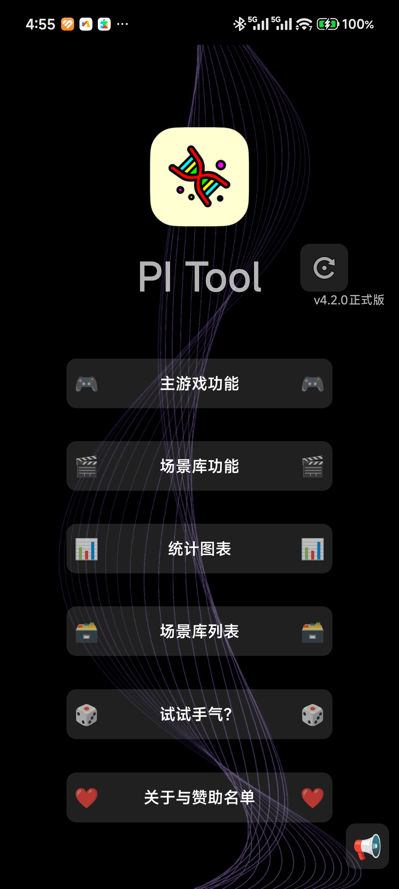
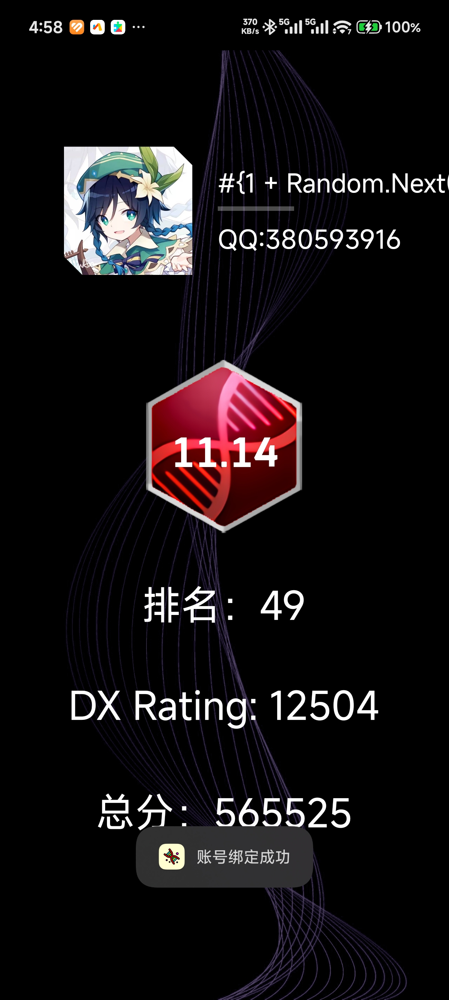
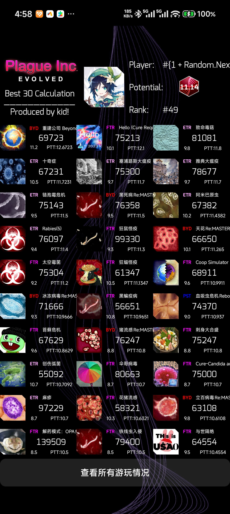
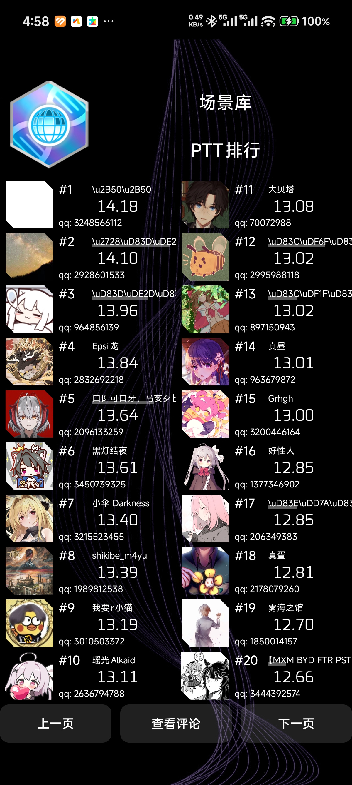
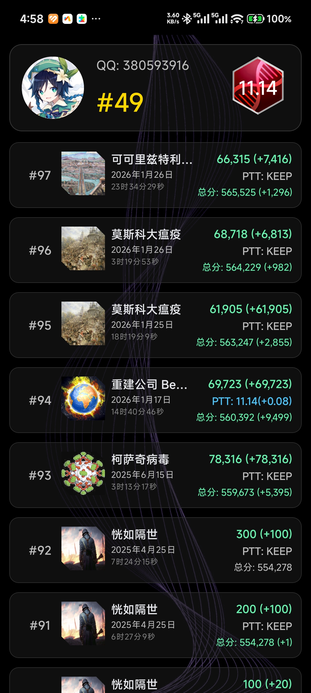
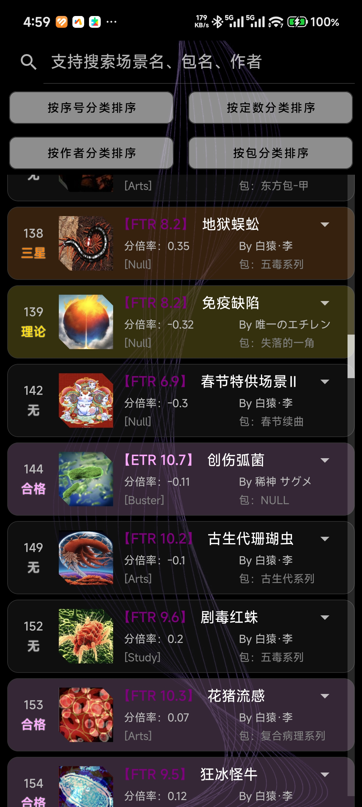
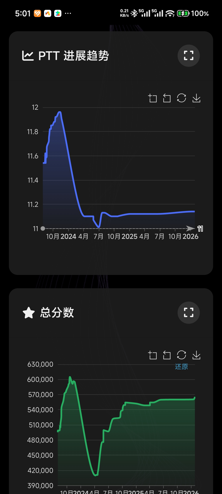

# PI-Tool —— 瘟疫公司玩家数据分析与社区平台

[](https://developer.android.com/)
[](https://www.oracle.com/java/)
[](https://www.sqlite.org/)
[](LICENSE)
[]()

<p align="center">
  
</p>

---


## 📱 项目简介

PI-Tool 是一款专为《瘟疫公司》(Plague Inc.) 玩家打造的 Android 辅助工具，提供完整的游戏数据统计、全球排行榜查询、玩家历史追踪、场景库管理及智能存档管理功能。项目采用模块化架构设计，支持多主题切换与离线缓存，为玩家社区提供专业的数据可视化服务。

> **注意**: 本项目为玩家社区开源项目，与 Ndemic Creations 官方无直接关联。

---

## ✨ 功能特性

### 🎮 核心游戏功能
| 模块 | 功能描述 | 状态 |
|:---|:---|:---|
| **B30 分析** | 玩家最佳30场成绩统计与PTT计算 | ✅ 稳定 |
| **历史追踪** | 个人成绩历史变化趋势分析 | ✅ 稳定 |
| **总分排行** | 全球玩家总分实时排行榜 | ✅ 稳定 |
| **场景库** | 完整场景数据查询与难度评级 | ✅ 稳定 |
| **存档管理** | 智能存档备份与悬浮窗快捷恢复 | ✅ 稳定 |

### 📊 数据可视化
- **实时排行榜**: 支持主游戏/剧情/急速/解药四大模式排行
- **PTT 计算系统**: 基于 Arcaea 评分算法的潜力值计算
- **场景定数查询**: 完整的场景难度定数数据库
- **个人数据看板**: 总分、排名、历史趋势一站式查看

### 🛠️ 工具集
- **分数计算器**: 支持主游戏/场景双模式分数预估
- **场景下载器**: 内置场景文件下载与一键启动
- **数据导入导出**: 支持 .k3a 存档文件管理
- **Web 图表**: 集成 ECharts 数据可视化

---

## 🖼️ 界面预览

### 主界面
<div align="center">

<br>
<small>主界面 - 功能导航与公告系统</small>
</div>

### 个人数据面板
<div align="center">

&nbsp;&nbsp;

<br>
<small>左：个人数据总览 | 右：B30 成绩分析</small>
</div>

### 排行榜系统
<div align="center">

&nbsp;&nbsp;

<br>
<small>左：全球总分排行 | 右：个人历史追踪</small>
</div>

### 场景库与工具
<div align="center">

&nbsp;&nbsp;

<br>
<small>场景列表 | 分数计算器</small>
</div>

### 数据可视化
<div align="center">

<br>
<small>Web 端数据可视化图表</small>
</div>

---

## 🏗️ 技术架构

```
PI-Tool/
├── 📱 应用层 (Presentation)
│   ├── Activity 层 —— UI 控制器与生命周期管理
│   ├── 自定义视图 —— DiagonalCutImageView 等组件
│   └── 适配器层 —— RecyclerView/ListView 数据绑定
│
├── 🔧 业务层 (Business)
│   ├── 异步任务 —— AsyncTask 网络请求封装
│   ├── 数据解析 —— JSON/CSV/TXT 多格式解析
│   └── 缓存管理 —— 本地文件与内存双级缓存
│
├── 🌐 数据层 (Data)
│   ├── REST API —— 自建服务器数据接口
│   ├── 文件系统 —— 外部存储权限管理
│   └── 图片加载 —— Glide 集成与离线缓存
│
└── 🎨 基础设施 (Infrastructure)
    ├── 悬浮窗服务 —— FloatingViewService 全局存档监控
    ├── 主题系统 —— 动态背景与深色模式支持
    └── 权限管理 —— Android 6.0+ 运行时权限适配
```

### 技术栈
- **语言**: Java 8
- **最低 SDK**: API 23 (Android 6.0)
- **目标 SDK**: API 33+
- **网络**: HttpURLConnection + 自定义异步封装
- **图片**: Glide 4.x (磁盘+内存缓存)
- **UI**: ConstraintLayout + Material Design 组件
- **存储**: SharedPreferences + 外部文件系统

---

## 🚀 快速开始

### 环境要求
- Android Studio Arctic Fox 或更高版本
- JDK 1.8+
- Android SDK API 23-33

### 构建步骤

```bash
# 克隆仓库
git clone https://github.com/your-org/pi-tool.git
cd pi-tool

# 使用 Android Studio 打开
# File → Open → 选择项目根目录

# 同步 Gradle 并构建
./gradlew assembleDebug

# 安装到设备
adb install app/build/outputs/apk/debug/app-debug.apk
```

### 配置说明
在 `MainActivity.java` 中配置服务器地址：
```java
// 主 API 服务器
private static final String API_BASE = "http://47.93.57.125:521/WebAPI/public/";
// 排行榜服务器  
private static final String LEADERBOARD_API = "http://47.93.57.125:4321/";
```

---

## 🔌 API 文档

### 数据接口

| 端点 | 方法 | 描述 | 响应格式 |
|:---|:---|:---|:---|
| `/Bests/{qq}.txt` | GET | 玩家最佳成绩 | `用户名,PTT,总分,评级,排名` |
| `/scores/{qq}.txt` | GET | 详细分数列表 | 多行 CSV |
| `/history/{qq}.txt` | GET | 历史记录 | 日期 场景名,分数变化,PTT变化... |
| `/Overalls/{qq}.txt` | GET | 综合统计 | 多维度通关数据 |
| `/scenInfo/scenList.txt` | GET | 场景元数据 | `ID,名称,倍率,类别,等级,定数,作者` |
| `/scenInfo/tops.txt` | GET | 场景库排行 | 排行榜数据 |
| `/icons/{id}.png` | GET | 场景/头像图标 | PNG 图像 |
| `/scenarioInfo_PITool.html` | GET | 场景详情页 | HTML 页面 |

### JSON API (新)

| 端点 | 描述 |
|:---|:---|
| `GET /vanillaQuery?qq={qq}` | 玩家完整数据查询 |
| `GET /vanillaLeaderboardQuery` | 全球排行榜数据 |
| `GET /cureQuery?qq={qq}` | 解药模式数据 |

---

## 🤝 贡献指南

我们欢迎社区贡献！请遵循以下流程：

1. **Fork** 本仓库并创建您的特性分支 (`git checkout -b feature/AmazingFeature`)
2. **提交** 您的更改 (`git commit -m 'Add some AmazingFeature'`)
3. **推送** 到分支 (`git push origin feature/AmazingFeature`)
4. 开启 **Pull Request**

### 代码规范
- 遵循 [Google Java Style Guide](https://google.github.io/styleguide/javaguide.html)
- 所有网络请求必须包含超时设置
- UI 更新必须在主线程执行
- 敏感操作需处理运行时权限

---

## 📄 开源许可

```
MIT License

Copyright (c) 2024 PI-Tool Contributors

Permission is hereby granted, free of charge, to any person obtaining a copy
of this software and associated documentation files (the "Software"), to deal
in the Software without restriction, including without limitation the rights
to use, copy, modify, merge, publish, distribute, sublicense, and/or sell
copies of the Software, and to permit persons to whom the Software is
furnished to do so, subject to the following conditions:

The above copyright notice and this permission notice shall be included in all
copies or substantial portions of the Software.

THE SOFTWARE IS PROVIDED "AS IS", WITHOUT WARRANTY OF ANY KIND, EXPRESS OR
IMPLIED, INCLUDING BUT NOT LIMITED TO THE WARRANTIES OF MERCHANTABILITY,
FITNESS FOR A PARTICULAR PURPOSE AND NONINFRINGEMENT...
```

---

## 🙏 致谢

- [Glide](https://github.com/bumptech/glide) - 图片加载与缓存
- [Material Components](https://github.com/material-components/material-components-android) - UI 组件库
- 瘟疫公司玩家社区 - 数据支持与测试反馈

---


